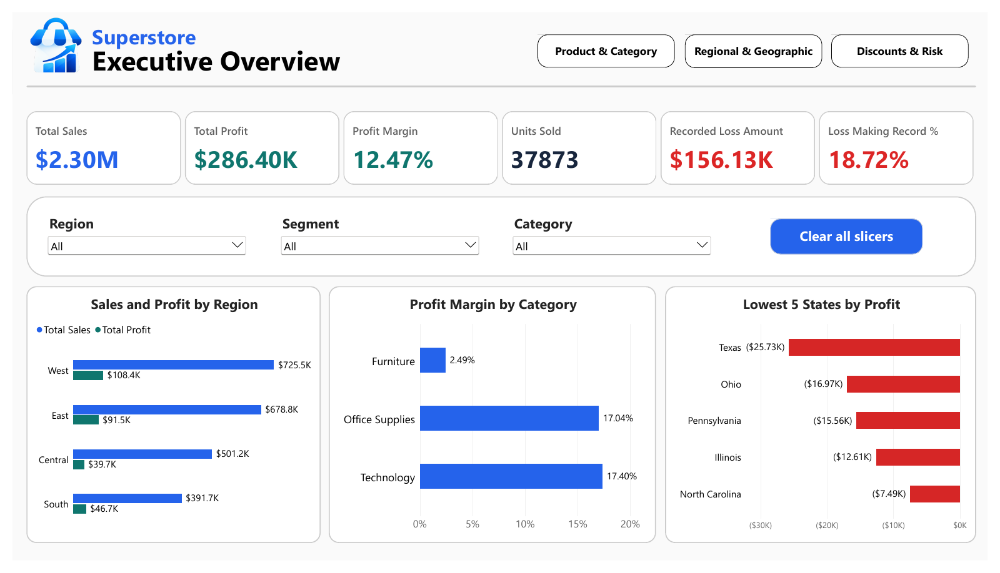

# Superstore Sales & Profitability Analytics

A four-page Power BI report exploring retail sales, profitability, product performance and discount-related risk.

**[View the complete PDF report](report.pdf)** · **[Download the Power BI file](Superstore.pbix)** · **[Dataset](SampleSuperstore.csv)**

## Business questions

Where are sales and profits generated? Which products and regions underperform? How do recorded discount levels relate to profitability and loss-making sales records?

## Report pages

1. Executive Overview: key measures, regional comparison and loss-making states.
2. Product & Category Performance: sub-category profit, segment/category margins and product detail.
3. Regional & Geographic Performance: state rankings, regional margins and geographic detail.
4. Discounts & Profitability Risk: discount bands, margins and loss-making record shares.

Region, segment and category slicers support comparisons, with navigation and a reset control in the Power BI file.

## Findings shown in the report

- Total sales of **$2,297,200.86** and total profit of **$286,397.02**, giving a **12.47% profit margin**.
- The West has the highest regional sales and profit; the Central region has a lower overall margin of **7.92%**.
- Furniture's **2.49%** margin is substantially below Office Supplies and Technology.
- **18.72% of sales records** have negative profit; Tables have the largest sub-category loss shown in the report.

These findings describe the supplied sample dataset. Discount comparisons show associations and do not establish that changing a discount alone will cause a particular profit outcome.

## View without a Power BI account

The [PDF](report.pdf) and screenshots can be viewed directly on GitHub. For interactive exploration, download this repository and open `Superstore.pbix` with Power BI Desktop on Windows. The PBIX is not a browser-hosted interactive report.

If a refresh reports a missing local CSV path, use **Transform data > Data source settings > Change Source** to select the included `SampleSuperstore.csv`. Check the existing query source in Power Query if needed, then refresh. The file was packaged from the existing project; a clean-machine refresh has not been verified.

## Files and context

- [Power BI report](Superstore.pbix)
- [Full PDF export](report.pdf)
- [Source CSV](SampleSuperstore.csv)
- [Product/category screenshot](product-category.png)
- [Discount risk screenshot](discount-risk.png)

Training portfolio project by Tejesh Ramesh Bawa, using the supplied Sample Superstore data. The original report and data are preserved. No licence for redistributing the source dataset is asserted here.
